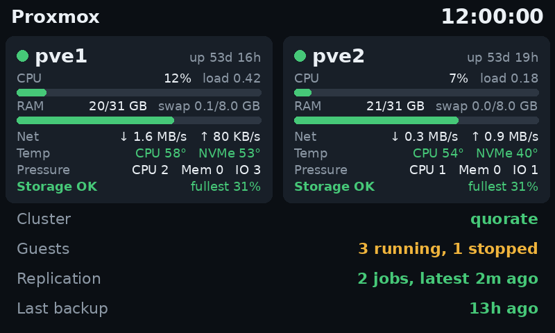
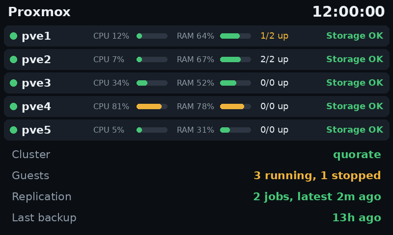
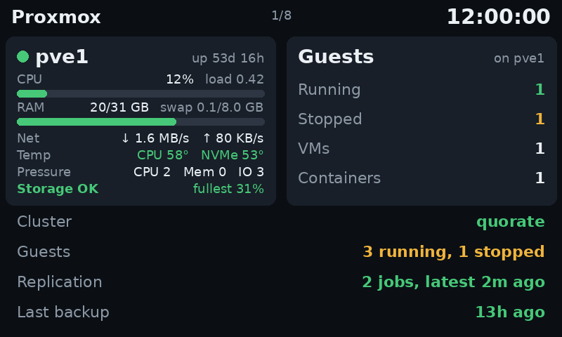
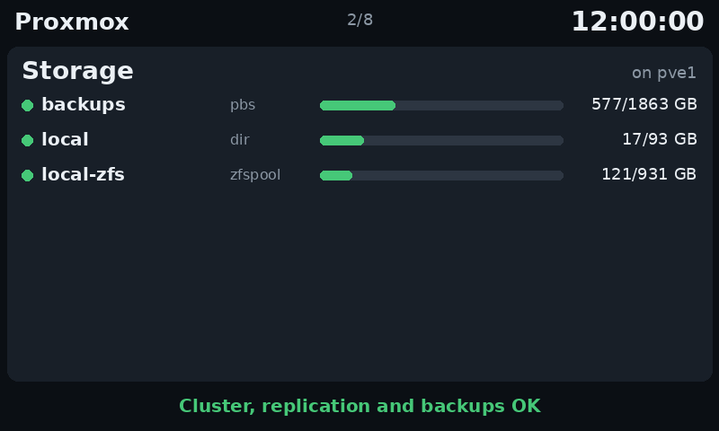
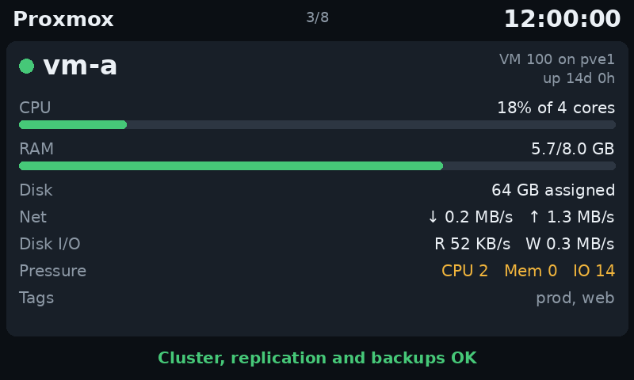
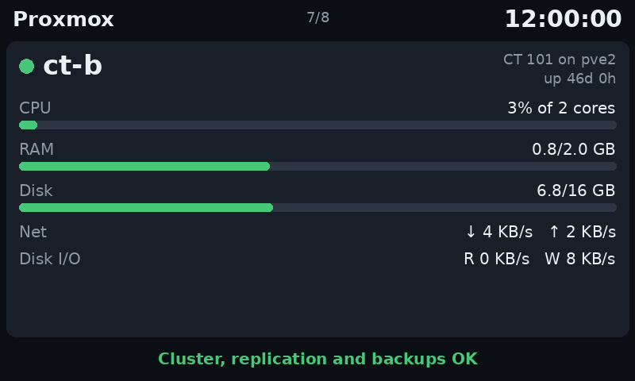
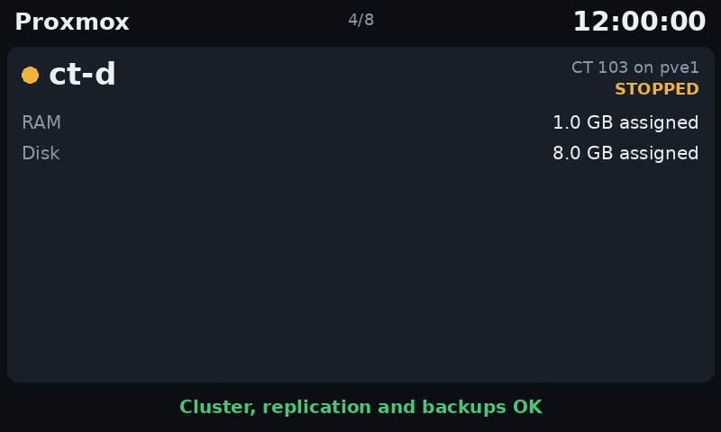
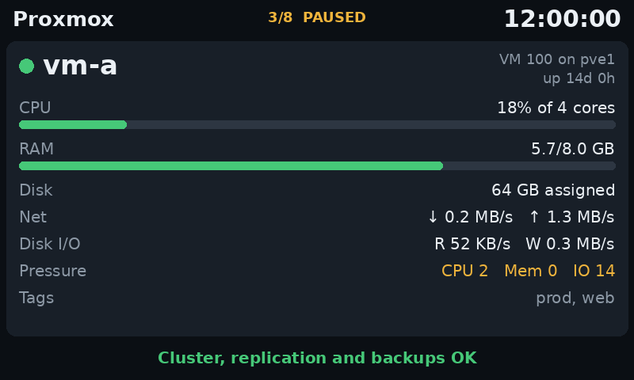
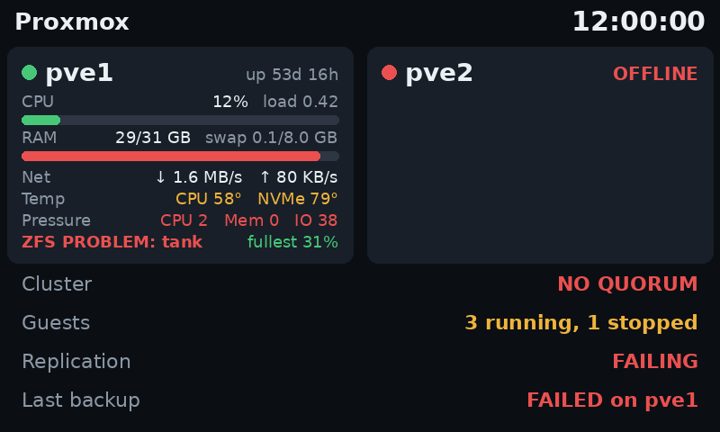

# VoCore Proxmox status screen

Turn a small [VoCore USB screen](https://vocore.io/screen.html) into a live status panel for a Proxmox VE host or
cluster. It runs as a small Python service on the host, with no kernel driver, no extra computer and read-only
access to the Proxmox API.



## What it shows

- **Each node:** online state, uptime, CPU and load average, RAM and swap, network rate, CPU and NVMe temperature,
  pressure, and storage: ZFS health, any storage that's down, and how full the fullest one is, whatever its type.
- **Cluster:** quorum, or `standalone` on a single host.
- **Guests:** how many VMs and containers are running or stopped. It turns amber if any are stopped.
- **Replication:** the most recent sync. Amber if nothing has synced for 60 minutes or one job is older than 26 hours;
  red if a job reports a failure.
- **Last backup:** the age of the oldest "latest backup" across the nodes, so a failure on one node isn't hidden by a
  good run on another.
- **Clock:** if it stops, the data is stale. The screen can't report that its own host has died, so keep separate alerts
  for that.

A section that can't be read shows `?` or `—` and the rest of the panel keeps working.

Bars turn amber at 75% and red at 90%. Temperatures use the same numbers.

### Views

Choose a view with `view` in the [configuration](#configuration). When a view needs more than one page, the screen moves
to the next page every `page_seconds` and shows the page number at the top.

| `view` | What each page shows |
|---|---|
| `summary` | Up to five nodes as one compact row each, plus the cluster lines |
| `hosts` (default) | Two node cards, plus the cluster lines. This is the picture above |
| `guests` | Each node's card and guest counts, its storage list, then one full page for each of its guests |

| `summary` | `guests`: a host |
|---|---|
|  |  |

| `guests`: storage | `guests`: a VM |
|---|---|
|  |  |

| `guests`: a container | `guests`: a stopped guest |
|---|---|
|  |  |

| Paused by touch | When things go wrong |
|---|---|
|  |  |

A guest page shows state, uptime, CPU, RAM, disk, network, disk I/O and tags. It has no room for the cluster lines, so
its bottom line shows the most serious cluster, replication or backup problem. Stopped guests don't count as a problem
there, because many are stopped on purpose.

Pressure is the percentage of time work was held up waiting for CPU, memory or disk I/O, a slowdown that CPU and RAM
figures can miss. It needs Proxmox VE 9 and shows `—` on older versions.
Guest pages only show the row if Proxmox reports pressure for that guest, which it does for VMs. A guest's pressure takes
one API call each time its page appears.

- A VM's disk use isn't reported without help from inside the guest, so VMs show their assigned size. Containers show a
  bar.
- Guest network and disk rates are worked out from two refreshes, so they show `—` until the second one.
- Every guest adds a page: 30 guests at the default 8 seconds take about four and a half minutes to come round.

## Why no kernel driver

VoCore's Linux driver is a kernel module, which would have to be rebuilt after every Proxmox kernel update and would run
inside your hypervisor's kernel. This project talks to the screen from userspace over libusb instead. If the service
crashes, the screen freezes and systemd restarts it; the host isn't affected.

## Requirements

- A VoCore screen that shows as `c872:1004` in `lsusb`.
- Proxmox VE on Python 3.11 or newer, which means PVE 8 or later.
- A USB cable that carries data, not only power.

**Tested on one panel only:** a 480×800 VoCore screen, used wide, on a two-node Proxmox VE 9 cluster. Other VoCore models share the
same USB ID but have different resolutions, and some have different driver boards. See
[Other panels](#other-panels).

## Install

Run everything as root on the host, except where noted.

### 1. Test the screen

This needs nothing except `python3-usb`, and it doesn't change anything on the screen permanently.

```bash
apt install python3-usb
python3 panel_test.py
```

You should see a mostly blue screen, a green strip along one long edge and a red block at one short end. Hold the screen
so the red block is on the left and the green strip is at the bottom: that's how the panel is drawn. If it's upside down
in your mount, set `flip = true` in step 4.

### 2. Install the service

Copy this folder to every node, or clone the repository there, then run this on each:

```bash
sh install.sh
```

It installs `python3-pil`, `python3-usb` and `fonts-dejavu-core`, creates a `vocore-status` system user, adds a udev rule
and starts the service. It's safe to run again.

**You can install it on every node.** With no screen attached, the service only sleeps and checks again every 30 seconds.
To move the screen, unplug it and plug it into another node.

### 3. Create a read-only API token

Do this once, on one node, because users and tokens are shared across a cluster.

```bash
pveum user add vocore@pve --comment "VoCore status screen"
pveum acl modify / --users vocore@pve --roles PVEAuditor
install -m 640 -g vocore-status /dev/null /etc/vocore-status/token
pveum user token add vocore@pve screen --privsep 1 --output-format json \
  | python3 -c 'import json,sys; print(json.load(sys.stdin)["value"])' \
  > /etc/vocore-status/token
pveum acl modify / --tokens 'vocore@pve!screen' --roles PVEAuditor
```

The secret is written straight to the file and never shown. Copy it to any other node:

```bash
ssh root@pve2 'install -m 640 -g vocore-status /dev/null /etc/vocore-status/token && cat > /etc/vocore-status/token' \
  < /etc/vocore-status/token
```

### 4. Start it

Edit `/etc/vocore-status/config.toml` if needed, restart the service on each node and replug the screen so the USB
permission applies:

```bash
systemctl restart vocore-status
```

### Updating

Get the new files, then run `sh install.sh` on each node again. Your `config.toml` stays as it is, so new settings use
their defaults until you add them.

## Configuration

Settings are in `/etc/vocore-status/config.toml`, and `install.sh` never overwrites them. After a change, run
`systemctl restart vocore-status`.

| Setting | Default | Meaning |
|---|---|---|
| `interval` | `15` | Seconds between data refreshes |
| `view` | `hosts` | `summary`, `hosts` or `guests`. See [Views](#views) |
| `page_seconds` | `8` | Seconds on each page when there is more than one |
| `brightness` | `60` | Backlight. Raise it if the screen looks dim |
| `flip` | `false` | Rotate 180° for an upside-down mount. Touch follows it |
| `touch` | `false` | Tap to change or pause the page. See [Touch](#touch) |
| `touch_invert` | `false` | Swap the left and right tap zones |
| `hide` | `[]` | Things not to show. See [Choosing what to show](#choosing-what-to-show) |
| `nodes` | `[]` | Node names in display order; empty uses the API's names, sorted |
| `pressure_warn` | `10` | Amber when CPU, memory or I/O pressure reaches this % |
| `pressure_bad` | `30` | Red when pressure reaches this % |
| `swap_warn` | `50` | Amber when this % of swap is used |
| `backup_warn_hours` | `26` | Amber if a node's latest backup is older than this |
| `replication_warn_minutes` | `60` | Amber if no job has synced for this long. Use more than your tightest schedule |
| `replication_max_hours` | `26` | Amber if any one job hasn't synced for this long. Use more than your slowest schedule |
| `temp_port` | `0` | See [Temperatures of the other node](#temperatures-of-the-other-node) |
| `poll` | `30` | Seconds between checks for a screen that isn't connected |

### Choosing what to show

List anything you don't want in `hide`, for example `hide = ["temp", "tags"]`.

| Item | Hides |
|---|---|
| `net` | The network row on host cards and guest pages |
| `temp` | The temperature row on host cards |
| `pressure` | The pressure row on host cards and guest pages |
| `load` | The load average on host cards |
| `swap` | Swap use on host cards |
| `disk_io` | The disk I/O row on guest pages |
| `tags` | The tags row on guest pages |
| `storage_pages` | The per-host storage list in `guests` view |

### Temperatures of the other node

The Proxmox API doesn't report temperatures, so each node reads its own sensors, and by default the other node's
`Temp` row shows `—`. To see both, set the same port on every node, for example `temp_port = 8765`.

The service then answers on that port with the CPU and NVMe temperatures. It has **no login** and listens on all
interfaces, so anything that can reach the port can read those two numbers. Keep it on a trusted network. If you use the
Proxmox firewall, allow the port between the nodes.

Only Intel CPU sensors (`coretemp`) and NVMe drives are read, so other CPUs show no CPU temperature.

## Touch

**Touch is experimental.** It can freeze, and when it does, only replugging the screen has fixed it. See
[below](#if-touch-freezes). The panel keeps working on its own if that happens.

With `touch = true`, the screen is split into three equal zones:

| Tap | Action |
|---|---|
| Left | Previous page |
| Middle | Pause or resume |
| Right | Next page |

Pausing keeps the current page on screen and shows `PAUSED` at the top. The clock and data keep updating, and left and
right still change the page, so you can move to the page you want and stay there. Pausing lasts until you resume or the
service restarts.

If left and right come out swapped, set `touch_invert = true`.

Check your screen first, because not every unit reports touch:

```bash
systemctl stop vocore-status
python3 touch_test.py --watch      # prints what the screen sends for 60 seconds
systemctl start vocore-status
```

Getting no reports doesn't prove the screen has no touch. `touch_test.py` has other modes for tracking down problems. Stop
the service first, as above:

| Command | What it does |
|---|---|
| `python3 touch_test.py` | Shows white targets and saves what the screen sends for each to `touch_capture.txt` |
| `python3 touch_test.py --watch` | Prints everything the screen sends for 60 seconds |
| `python3 touch_test.py --frames` | Checks whether sending frames stops touch. Tap while the screen is white |
| `python3 touch_test.py --revive` | Checks when touch stops and what brings it back |
| `python3 touch_test.py --thaw` | Run while touch is frozen, to try clearing it from software |

The last three need no keyboard, so you can start them and walk over to the screen.

**Tested on one panel only.** That panel stops reporting touch soon after it's woken, so with `touch = true` the
service resends the wake command every 3 seconds. It may also send reports that repeat old data, or contain junk with
no touch point, particularly just after startup. Those reports can't be trusted for position, so a tap with no fresh position
acts as "next", or resumes if paused. Touch reports use the panel's own 480×800 coordinates, not the wide layout.

### If touch freezes

Taps still register, but always as if at the same spot, and the log shows `tap: tap` with the same report every time. The
cause isn't known yet. A tap then acts as "next", or resumes if paused. A USB reset, a USB disconnect in software and
turning the display off and on don't clear it, so replug the screen.

## Security

- The API token has the read-only `PVEAuditor` role, and the service never writes to Proxmox.
- The token file can only be read by root and the `vocore-status` user.
- The service connects to Proxmox on the same machine, so it doesn't check the certificate.
- `temp_port` is the only thing it listens on, and it's off by default.

## Troubleshooting

| Symptom | Check |
|---|---|
| `?` or `API unavailable` on screen | `journalctl -u vocore-status` shows which request failed |
| Screen stays blank | Replug it so the udev rule applies, and check `lsusb` |
| Stale time on the clock | `systemctl status vocore-status` |
| Screen looks stuck on one page | There's only one page in that view, or `page_seconds` is long |
| Taps always go forward | The log shows `tap: tap` with the same report every time: touch has frozen. Replug the screen. A USB reset doesn't clear it |
| Taps do nothing | `journalctl -u vocore-status -n 20` shows `touch on` or `touch off` at startup, and a `tap:` line for each tap the service reads |
| `Temp` shows `—` for another node | Set `temp_port` on every node and restart each service. See [Temperatures of the other node](#temperatures-of-the-other-node) |
| A VM shows I/O pressure near 100% with nothing wrong | Some VMs with `io_uring` disks report this on Proxmox VE 9. Raise `pressure_warn` and `pressure_bad`, or hide `pressure` |
| Wrong time zone | The clock follows the node's time zone: `timedatectl` |
| Backup says `none listed` | The cluster task list is short, so a lot of other tasks can push backups out of it |

To see exactly what the service reads from the API:

```bash
sudo -u vocore-status python3 /opt/vocore-status/vocore_status.py --dump
```

The output contains your node names, IPs and guest names, so review it before sharing it.

## Other panels

`WIDTH` and `HEIGHT` at the top of `vocore_status.py`, and the layout in `render()`, assume 800×480. So do the tap zones
and `touch_test.py`. For another size:

1. Run `python3 panel_test.py <line> <lines>`, for example `480 854` for the 5" panel.
2. Check the result, because orientation may differ.
3. Adjust the sizes, `to_frame()` and the layout.

Pull requests with results from other models are welcome.

## Uninstall

On each node:

```bash
sh uninstall.sh
```

Then remove the API user once with `pveum user delete vocore@pve`. The Python and font packages stay installed.

## Development

The panel can be rendered and tested without a screen or Proxmox. This needs `python3-pil` and `python3-usb`:

```bash
python3 test_status.py
python3 vocore_status.py --preview guest.png fixture.json guests 3   # view, then page number
python3 docs/make_screens.py                                         # the screenshots in this README
```

The code is one file, `vocore_status.py`. `fixture.json` holds made-up data for the tests and screenshots.

## How the screen works

The protocol is small. Frames are RGB565 little-endian, sent as 800 lines of 480 pixels.

| Step | Transfer |
|---|---|
| Wake | Control OUT `0x40`, request `0xB0`, data `00 29` |
| Brightness | Control OUT `0xB0`, data `00 51 02 00 00 00 <value> 00` |
| Frame start | Control OUT `0xB0`, data `00 2C <size, 3 bytes little-endian> 00` |
| Frame data | Bulk OUT endpoint `0x02` |
| Touch | Interrupt IN endpoint `0x81`, 14 bytes |

Touch report bytes, as seen on one panel:

| Byte | Meaning |
|---|---|
| 2 | Number of fingers |
| 3 | Top two bits: 0 down, 1 up, 2 held. Low four bits: top of X |
| 4 | Rest of X |
| 5 | Top four bits: point ID. Low four bits: top of Y |
| 6 | Rest of Y |
| 9–13 | The second point, in the same layout |

X runs along the panel's 480-pixel edge and Y along its 800-pixel edge.

The panel boots asleep, so it has to be woken after every replug. This project always sends whole frames, because
partial updates were [reported to shift later frames](https://github.com/ggurov/usb-rectangle-screen-gauge).

## Credits

The display protocol details came from these projects, and no code was copied from either:

- [vocore-screen-py](https://github.com/bitshift91/vocore-screen-py) by Nicolas Meisberger
- [usb-rectangle-screen-gauge](https://github.com/ggurov/usb-rectangle-screen-gauge)

The touch report layout comes from VoCore's own [mpro_drm](https://github.com/Vonger/mpro_drm) driver.

Not affiliated with VoCore or Proxmox.

## License

MIT
